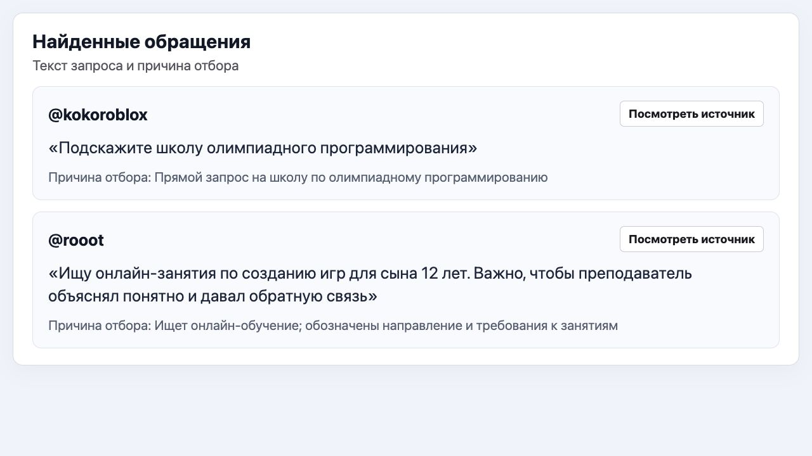
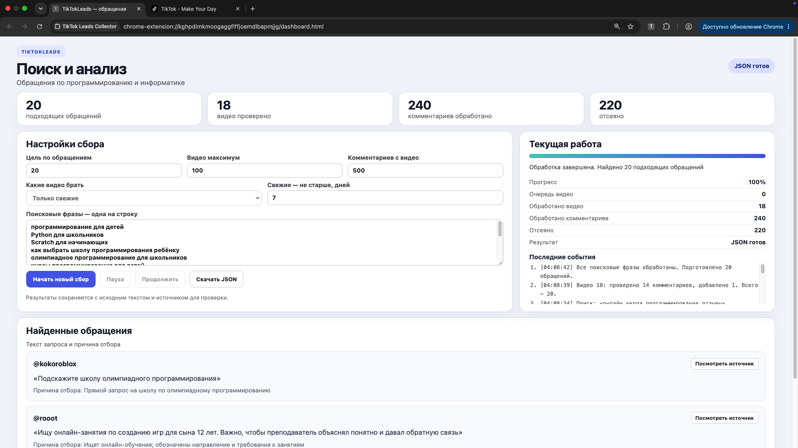

# TikTokLeads

### Поиск и квалификация запросов на обучение в TikTok

Разработал браузерное расширение, которое собирает открытые комментарии к тематическим видео, выделяет запросы на обучение и сохраняет обращения вместе с контекстом. Менеджер получает очередь для проверки: исходный текст, автора, ссылку на видео и объяснение отбора.

**Автор — Амин Гадельшин.** Мой вклад: сбор данных, логика фильтрации и оценки, интерфейс расширения, сохранение прогресса, реестр обращений и выгрузка результатов.

## Что видит менеджер

*Демонстрационные карточки из интерфейса проекта. Фрагмент показан крупнее для удобства чтения. Тексты, имена и числовые значения в демонстрации иллюстративные; они не являются отчётом о реальных клиентах или продажах.*

[Открыть фрагмент отдельно](assets/leads-detail.jpg) · [Посмотреть полный экран](assets/demo-overview.png)

## Какую задачу решает инструмент

В обсуждениях образовательных видео встречаются конкретные запросы: какую школу выбрать, где найти занятия, сколько стоит подготовка, есть ли подходящий курс. При ручном поиске приходится открывать ролики, читать комментарии, отделять запросы от обычного обсуждения и сохранять найденное.

Я собрал этот процесс в одном инструменте. Он берёт на себя поиск и предварительную квалификацию. Менеджер проверяет исходный контекст и решает, какие обращения подходят для дальнейшей работы.

## Сценарий работы

1. **Настроить поиск.** Пользователь задаёт поисковые фразы, цель по количеству обращений, ограничения по видео и комментариям. Для свежих видео можно установить окно по давности публикации.
2. **Найти тематические видео.** Расширение проходит результаты поиска, исключает уже обработанные ролики, слишком старые публикации и явные рекламные материалы. Отдельный режим работает с тематической лентой.
3. **Собрать комментарии.** Для каждого принятого видео инструмент получает открытые комментарии и ограниченное число ответов в обсуждениях. Сохраняет текст и связь с исходной публикацией.
4. **Оценить обращение.** Проверяет тему, признаки выбора обучения, запрос цены, совета или сравнения форматов. Отсекает нерелевантные сообщения и объясняет решение.
5. **Передать на проверку.** Подходящие обращения появляются в очереди и реестре. Менеджер может проверить источник, изменить статус и зафиксировать причину отказа.
6. **Сохранить результат.** Данные выгружаются в JSON. Реестр также можно скачать вместе со статистикой по статусам.

**Поток данных:** поисковые фразы → видео → комментарии → фильтры и оценка → очередь проверки → реестр и выгрузка.

## Как устроен отбор

В текущей версии используется классификация по правилам и контексту. Она учитывает формулировку запроса, образовательную тему, признаки намерения выбрать обучение и давность сообщения. Это позволяет показать менеджеру конкретную причину отбора.

Квалификация присваивает обращению оценку от 0 до 100 и категорию: горячее, тёплое, холодное или нерелевантное. Балл помогает упорядочить очередь; он не означает вероятность покупки. Автоматического решения недостаточно, поэтому итоговый выбор остаётся за человеком.

| Сигнал в сообщении | Что проверяет инструмент |
| --- | --- |
| Выбор школы или курса | Есть ли запрос на обучение, совет или сравнение вариантов |
| Вопрос о стоимости | Относится ли вопрос к подходящему образовательному направлению |
| Реклама преподавателя или собственного курса | Требуется ли исключить сообщение как предложение продавца |
| Обучение уже куплено, экзамен уже сдан | Есть ли новый актуальный запрос |
| Другое направление или обычное обсуждение | Соответствует ли сообщение заданным критериям |

Рабочая квалификация ориентирована на образовательные услуги и настраиваемый список учебных предметов. В визуальной демонстрации использован условный сценарий школы программирования для детей. Экран показывает устройство карточек; он не подтверждает качество отбора для каждого направления обучения.

## Что сохраняется в карточке

- исходный текст комментария и автор;
- ссылка и идентификатор видео, время сбора;
- тема и тип запроса;
- оценка, категория и причины отбора;
- статус обработки и причина отклонения, если она указана.

Реестр связывает найденное обращение с дальнейшей работой: квалификация, передача менеджеру, контакт, ответ, интерес, отправленная ссылка, конверсия или отказ. Статусы меняются вручную. Повторные обращения проверяются по автору и тексту, чтобы не создавать одинаковую работу заново.

## Управление и поддержка

Сбор ограничен заданными лимитами и может быть поставлен на паузу. Расширение сохраняет настройки, очередь, обработанные видео и промежуточные результаты в локальном хранилище Chrome. Это позволяет продолжить сохранённый проход и не повторять уже выполненную обработку.

В интерфейсе видны текущий этап, счётчики и журнал событий. По ним можно понять, что уже обработано и где возникла ошибка. Для тематической ленты предусмотрены повторные попытки восстановления после временных проблем загрузки.

## Техническое устройство

Проект реализован на **JavaScript** как расширение **Chrome Manifest V3**. Фоновый service worker открывает интерфейсы инструмента; страницы сбора управляют обработкой видео и комментариев. Отдельные модули отвечают за оценку сообщений, квалификацию и реестр.

Для сохранения состояния используется **Chrome Storage API**, для передачи результатов — **JSON**. Интерфейс написан на HTML и CSS. Исходный код расширения и рабочие выгрузки в этом репозитории не публикуются: здесь представлены описание проекта и демонстрационные экраны.

## Полный экран

[Открыть исходное изображение 1920×1080](assets/demo-overview.png)

## Результат для команды

Вместо разрозненных заметок менеджер получает структурированную очередь с исходным текстом, причиной отбора и переходом к публикации. Инструмент сокращает объём повторяющихся действий при поиске и сохраняет историю обработки обращений.

Этот кейс показывает реализованный процесс и мою работу над ним. Производственные показатели продаж и точности отбора в публичную демонстрацию не включены.
